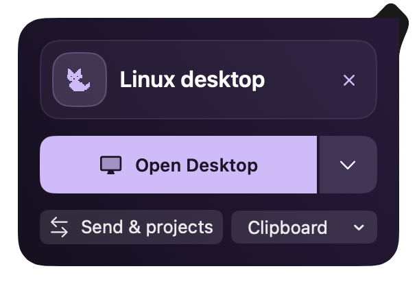

# Handoff Fox

**Your Linux desktop, one click from your Mac.**

Keep your Linux workspace running while you work on your Mac. Click the fox in the menu bar to open the desktop, send a file or link, or jump back into a saved project.

[Build from source](docs/SETUP.md) · [First preview release](https://github.com/Niraven/handoff-fox/releases/tag/v0.1.0-preview.1) · [Tell us what works on your setup](https://github.com/Niraven/handoff-fox/issues/new?template=preview-feedback.md)

## What you can do

| When you need to… | Use Handoff Fox to… |
| --- | --- |
| Finish something on Linux | Resume a Hyprland desktop in Mirror or Private Screen and keep your preferred scale. |
| Move a file, link, or snippet | Send and retry handoffs through the Mac’s Transfer Inbox, or share plain text through the clipboard. |
| Pick up a project or run a job | Open a saved Linux folder or start an approved build preset that keeps running if your Mac disconnects. |

Pairing uses your existing SSH access. The Mac checks the Linux host key and installs a user-level receiver when needed. A Tailscale connection was used in the live desktop test. The Linux machine can also be reached through a verified SSH alias on your network.

The fox reacts to reconnects and can show the state of an approved Linux job. Drop a local file on the fox in Mac Quick Actions or on the Linux tray card to send it to the paired device.

## Try the source preview

Start with an **Apple Silicon Mac** and a **Linux machine you can reach with an SSH key**. For desktop control, use a running Hyprland session with Gliff installed. The desktop flow has been exercised on Omarchy. The receiver has also been exercised on a separate Debian SSH setup.

1. [Build and launch Handoff Fox](docs/SETUP.md).
2. Click the fox, pair your Linux SSH address, and select **Open Desktop**.
3. [Share your distro, compositor, and how far you got](https://github.com/Niraven/handoff-fox/issues/new?template=preview-feedback.md).

This release ships source for a local build. A downloadable Mac installer needs Developer ID signing and notarization. [Apple’s distribution guidance](https://developer.apple.com/developer-id/)

## What’s next

1. Verify physical sleep and wake, LAN-to-Tailscale recovery, and different keyboard and display setups.
2. Time a first pairing on a clean Mac and verify which actions work on Omarchy, another Hyprland distro, and headless Linux.
3. Test a Developer ID-signed, notarized Mac installer on a clean Mac.

[Product vision](VISION.md) · [Roadmap and acceptance tests](docs/ROADMAP.md) · [Contributor instructions](AGENTS.md)

[Development and upstream updates](docs/DEVELOPMENT.md) · [MIT license](LICENSE) · [Third-party notices](dependencies/licenses/README.md)
